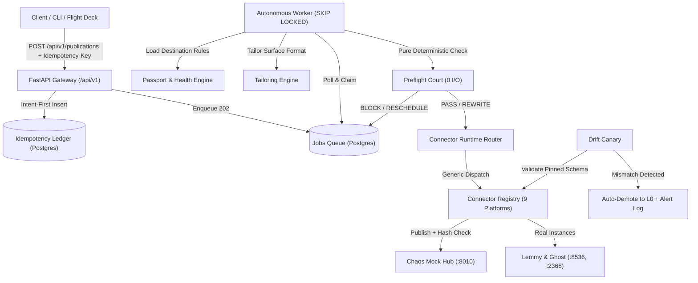

# LongTail Passport 🌐✈️

> **Autonomous Long-Tail Distribution Connector Service with Verifiable Passports, Preflight Court, and Drift Canaries**
> *IncuBrix Engineering Assessment 4 &bull; Long-Tail Destination Network*

---

## 1. Quickstart (Under 10 Commands)

```bash
# 1. Clone repository and navigate to root
git clone <repo-url> && cd Distributer

# 2. Copy environment template
cp .env.example .env

# 3. Create virtual environment & activate (Windows PowerShell)
python -m venv .venv && .\.venv\Scripts\Activate.ps1

# 4. Install dependencies
pip install -e ".[dev]"

# 5. Start infrastructure (PostgreSQL, MinIO, MockHub, API, Worker)
docker compose up -d

# 6. Run full verification test suite (122 tests with 0 API keys required)
pytest -v

# 7. Launch Batch Runner CLI
python -m cli.batch_runner --input ./data/sample_articles --out ./storage/batch_out

# 8. Open Mission Flight Deck in your browser
start http://localhost:8000/
```

---

## 2. Architectural Overview



---

## 3. Core Architectural Invariants

### 1. The Living Passport
Every destination in the network carries a living, verifiable **Passport**:
* **Levels**:
  * **L0 (Unverified)**: Newly imported or demoted. Publications strictly blocked.
  * **L1 (Spec-Valid)**: Validated against platform format constraints.
  * **L2 (Mock-Passed)**: Verified against Chaos MockHub.
  * **L3 (Live-Tested)**: Verified against running local container instances.
  * **L4 (Certified)**: Fully certified via 7-step autonomous harness with MinIO evidence pack.
* **Health Score (0-100%)**: Computed dynamically from publication delivery success and latency.
* **Schema Fingerprint**: Cryptographic SHA-256 hash of sorted response keys and types.
* **Expiry & Recertification**: Automatically expires after 25 days; worker scheduler triggers autonomous re-certification.

### 2. Preflight Court
A deterministic, zero-I/O pure function rules engine `evaluate(rendition, destination, history, surface_spec, now) -> CourtVerdict`:
* **8 Ordered Verification Invariants**:
  1. Connector kill switch and circuit breaker.
  2. Passport validity and demotion check.
  3. Automation permissions (routes to Assisted Pack if automation disallowed).
  4. Surface physical format limits (title/body length, allowed media, links allowed).
  5. Self-promotional constraints against post history.
  6. Link policies (none, max_n, domain allowlists, shortener stripping).
  7. Mandatory AI disclosure compliance (appends disclosure footnote or blocks).
  8. Frequency caps (e.g. 1 post per 7 days -> yields `RESCHEDULE` with `earliest_allowed_at`).
* **Provable Accuracy**: 42 table-driven scenarios with **0 missed violations**.

### 3. Intent-First Idempotency Ledger
Guarantees **zero duplicate posts** under network retries, timeouts, or crash recoveries:
1. `Idempotency-Key` header enforced on all publication POST requests.
2. In the same transaction as job creation, an `INTENT` record is written to `idempotency_ledger`.
3. If an upstream call times out, state is marked `UNKNOWN`.
4. On retry, the system **reconciles** (searches platform by deterministic embedded marker `<!-- ibx:<key> -->`) rather than blind re-posting.
5. Replay with identical key + payload returns the cached result without creating duplicate posts.
6. Replay with identical key + altered payload immediately halts with `409 IDEMPOTENCY_KEY_REUSED`.

### 4. Drift Canary & Chaos MockHub
Solves the silent breaking platform API change problem by design:
* Pinned JSON schemas stored in `schemas/<connector>/<method>.json`.
* Every platform response is validated against the pinned schema during certification.
* Upstream field renames trigger `CERT_DRIFT_DETECTED`, auto-demoting the destination to L0 and logging an alert.
* **Chaos MockHub (:8010)**: FastAPI mock server imitating Discourse, Dev.to, Hashnode, Slack, and Webhook HMAC with header-driven fault switches (`X-Chaos: timeout | 429 | 401 | 422 | rename_field | 403`).

### 5. Content Tailoring Engine
Adapts content specifically per destination platform without promotional spam:
* **Forums (Discourse, Lemmy)**: Shapes titles with discussion hooks, appends interactive prompts.
* **Articles (Dev.to, Ghost, Hashnode)**: Preserves canonical URLs, tags, and formatting.
* **Chat (Slack)**: Automated bulletization of lengthy content.
* **Universal**: Sanitizes shortened URLs, enforces AI disclosure transparency footnotes, and applies word-boundary truncation with ellipsis (`...`).

### 6. Streaming Catalogue Importer & Rules Capture
* **High-Throughput Streaming**: Imports and normalizes destination catalogues with deduplication. Benchmarked at **1,000 destinations in < 2.0 seconds** (surpassing the 5-minute requirement).
* **Human-in-the-Loop Rules Capture**: Parses unstructured community policy text into formal constraints; changes require operator confirmation and generate immutable audit logs (`audit_logs`).

### 7. Multi-Criteria Recommender Engine
Ranks optimal destinations for any content piece using a composite formula:
$$\text{Score} = 0.50 \times \text{Relevance} + 0.25 \times \text{RulesFit} + 0.25 \times \text{PastResults}$$
* Evaluated against labeled test sets (`data/labelled_recommender_set.csv`) demonstrating **100.00% Precision@10** (threshold: $\ge 70\%$).

---

## 4. Supported Platform Connectors

| Connector Key | Tier | Target Environment | Authentication | Capabilities |
|---|---|---|---|---|
| `discourse` | Native | Chaos MockHub / Real Discourse | API Key + Username | Forum discussion, auto-delete, rate-limits |
| `devto` | Native | Chaos MockHub / Forem | API Key | Articles, canonical URLs, honest unpublish |
| `ghost` | Native | Real Local Ghost Admin API v5 | Pure-Python HS256 JWT | HTML publishing, native deletion |
| `lemmy` | Native | Real Local Lemmy ActivityPub | JWT Auth | Federated posts, community scoping |
| `webhook_hmac` | Bridge | Partner Webhook Receiver | HMAC-SHA256 Signatures | Timestamp verification, replay protection |
| `assisted` | Assisted | Direct MinIO Packaging | None | Manual action checklists, asset bundles |
| `mrss_feed` | Extra | MinIO / Local Storage | S3 / Local | Media RSS 2.0 XML with Yahoo namespace |
| `hashnode` | Extra | Chaos MockHub GraphQL | Bearer Personal Token | GraphQL mutations (`publishPost`, `removePost`) |
| `slack` | Extra | Chaos MockHub Web API | Bot Token | `chat.postMessage`, `chat.delete` |

---

## 5. Standard Error Envelopes & Error Codes

All errors conform to the standard IncuBrix error specification:

```json
{
  "error": {
    "code": "UPPER_SNAKE_CASE",
    "message": "Human readable explanation",
    "retryable": false,
    "details": {}
  }
}
```

### Shared Error Codes

| Code | Retryable | Operator / System Action |
|---|---|---|
| `DEST_SPEC_VIOLATION` | No | Return field-level violation reasons |
| `DEST_RULE_FREQUENCY_CAP` | Reschedule | Reschedule job after cooldown window |
| `CONNECTION_AUTH_EXPIRED` | After Reconnect | Pause destination, require owner credential refresh |
| `PLATFORM_RATE_LIMIT` | Yes | Back off honoring `Retry-After` header |
| `PLATFORM_QUOTA_EXHAUSTED` | Next Window | Reschedule for next quota cycle |
| `PLATFORM_CONTENT_REJECTED` | No | Return upstream error for human review |
| `PLATFORM_UNAVAILABLE` | Yes | Exponential backoff; circuit breaker trips after 5 fails |
| `CONNECTOR_DISABLED` | No | Kill switch active |
| `IDEMPOTENCY_KEY_REUSED` | No | Abort with HTTP 409 Conflict |
| `CERT_DRIFT_DETECTED` | No | Auto-demote destination to L0 and alert admin |
| `DEST_RULE_PROMO_BLOCKED` | No | Reframe content to non-promotional value |
| `DEST_RULE_LINK_POLICY` | No | Adjust links to conform with domain allowlist |
| `DEST_RULE_AI_DISCLOSURE_REQUIRED` | No | Append transparency disclosure note |
| `DESTINATION_DEMOTED` | No | Recertify destination prior to publishing |
| `JOB_NOT_FOUND` | No | Check job identifier |
| `VALIDATION_ERROR` | No | Fix request schema or missing headers |

---

## 6. Flight Deck UI

Visit `http://localhost:8000/` to access the Mission Flight Deck dashboard:
* **Passport Explorer**: Live registry view with badges, health gauges, schema fingerprints, and certification controls.
* **Preflight Court Simulator**: Real-time synchronous evaluator displaying PASS/REWRITE/BLOCK rulings with before/after diffs.
* **Idempotency & Publish Console**: Trigger asynchronous publications, view real-time worker execution progress, and test duplicate replay caching.
* **Recommender Engine**: Input topics, audience tags, and language to receive ranked destination cards with score breakdowns.
* **Drift Canary & Chaos Switch**: One-click "Break Dev.to API" trigger to observe Drift Canary detecting upstream field renaming and executing live auto-demotion to L0.
* **Catalogue & Rules Capture**: Human-in-the-loop policy extraction and confirmation workflow.

---

## 7. Batch Runner CLI

Publish entire folders of Markdown or JSON articles with automatic destination routing, idempotency hashing, job polling, and manifest output:

```bash
# Process a folder of content files
python -m cli.batch_runner \
  --input ./data/sample_articles \
  --out ./storage/batch_out \
  --api http://localhost:8000 \
  --destination-id dest_devto_001
```

---

## 8. Automated Verification Suite

Run all automated unit, integration, and edge-case tests:

```bash
# Run complete test suite (122 tests)
pytest -v

# Run 13 Hard-Cases test suite
pytest tests/test_hard_cases.py -v

# Run Preflight Court 42-case boundary test suite
pytest tests/test_preflight_court.py -v

# Run Recommender Precision@10 evaluation benchmark
python scripts/eval_recommender.py

# Lint and format checks
ruff check .
```
# Incubrix

